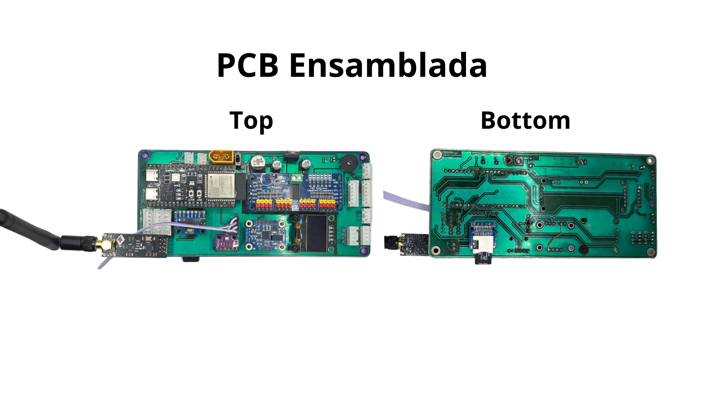
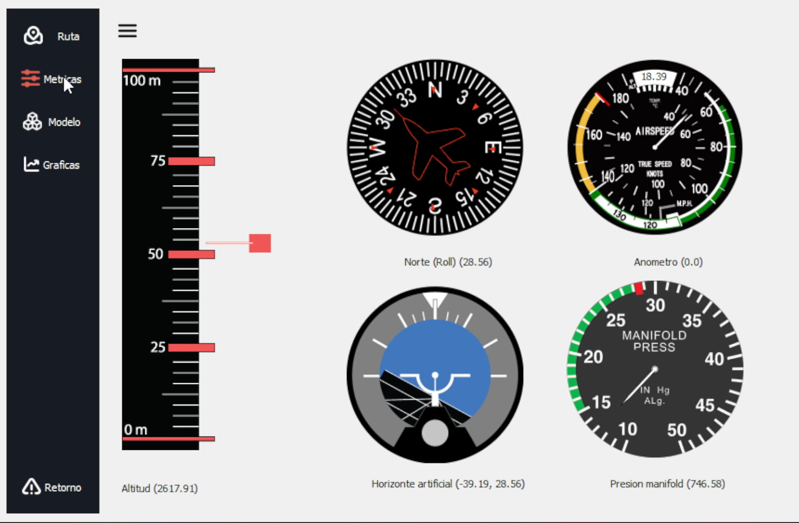
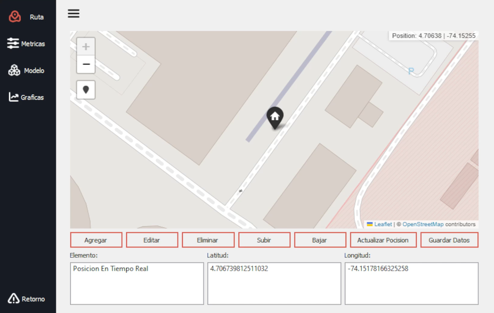

# Flight Controller and Ground Control Station for a Fixed-Wing UAV

> **Bachelor's thesis (Proyecto de Grado), Electronic Engineering, Universidad de los Andes**
> Author: **Yesid Camilo Almanza Gamba** · Advisor: **Prof. Alba Ávila Bernal**

📄 **[Read the full thesis (PDF, Spanish)](Documento/YesidAlmanza_Tesis_201921773.pdf)** · 🎥 **[Watch the project video](https://youtu.be/uGze4ZMjyZo)**

This project covers the design, build and flight testing of a custom **flight controller for fixed-wing UAVs** based on the **ESP32-S3** (replacing the usual STM32 architecture), along with a **desktop ground control station (GCS)** that shows telemetry in real time and reconstructs the flight path from GPS and altitude data.

<p align="center">
  
</p>

## Video

<p align="center">
  <a href="https://youtu.be/uGze4ZMjyZo">
    
  </a>
</p>

---

## Features

- **Custom PCB** (KiCad) built around the ESP32-S3 DevKitC-1, with a 3D-printed enclosure.
- **Sensor suite:** BNO055 and MPU6050 IMUs, BMP280 barometer, MS4525 differential-pressure airspeed sensor, NEO-6M GPS and HMC5883L magnetometer.
- **Actuation:** PCA9685 16-channel PWM driver for servos and ESC, driven by a FlySky receiver over iBus/PPM.
- **Telemetry link:** nRF24L01 2.4 GHz radio from the aircraft to a ground receiver.
- **Onboard logging:** flight data is written to a microSD card.
- **Ground control station** (Python + PyQt5): artificial horizon, heading, 3D aircraft model, live plots, a live map (Folium) and data export to JSON/CSV.
- **Post-flight analysis scripts** that produce plots and 2D/3D trajectory maps from logged flights.

<p align="center">
  
  
</p>

## System overview

```
 ┌───────────────── Aircraft ─────────────────┐            ┌──────────── Ground ────────────┐
 │ IMU / Baro / Airspeed / GPS ──► ESP32-S3   │  nRF24L01  │ ESP32-S3 receiver ──USB/serial─┼─► PyQt5 GCS
 │ FlySky RX (iBus/PPM) ──────────►  │        │ ─────────► │  (src/recepcion.cpp)           │   (src/interfazWave)
 │                         PCA9685 ◄─┘──► SD  │            └────────────────────────────────┘
 │                         servos / ESC       │
 └────────────────────────────────────────────┘
```

## Repository layout

| Path | Contents |
|---|---|
| `src/` | Firmware (C++/Arduino, PlatformIO) |
| `src/sensorica/` | Sensor drivers and fusion (IMU, barometer, airspeed, GPS) |
| `src/control/` | Servo / control-surface regulation (`ReguladorServos`) |
| `src/navegacion/` | Control loop and waypoint navigation |
| `src/telemetria/` | FlySky receiver handling |
| `src/utilities/` | OLED display helper |
| `src/main.txt` | **Onboard flight-controller program** (see *Building the firmware*) |
| `src/recepcion.cpp` | **Ground receiver program** (nRF24 → serial / SD) |
| `src/archivosDePrueba/` | Standalone test sketches for individual sensors |
| `src/interfazWave/` | Ground control station (Python / PyQt5) |
| `test/graphs_files/` | Post-flight analysis and plotting scripts |
| `flight_tests/` | Raw flight logs (CSV/JSON), generated plots and HTML maps |
| `PCB/` | KiCad projects (Delta 1.0, Delta 2.0), footprints, symbols, 3D models and fabrication outputs |
| `Documento/` | LaTeX source of the thesis plus the compiled PDF |

## Getting started

### Building the firmware

Requirements: [PlatformIO](https://platformio.org/) (VS Code extension or CLI). Library dependencies are listed in `platformio.ini` and download automatically on the first build.

PlatformIO compiles every `.cpp` file in `src/`, so **only one program with `setup()`/`loop()` can be active at a time**. The inactive ones are stored as `.txt`:

- **Ground receiver** (default): `src/recepcion.cpp` is active.
- **Flight controller:** rename `src/recepcion.cpp` → `recepcion.txt` and `src/main.txt` → `main.cpp`.

```bash
# set upload_port in platformio.ini to your board's port first (COM10 by default)
pio run -t upload
pio device monitor     # 115200 baud
```

### Running the ground control station

Requirements: Python 3.9+.

```bash
cd src/interfazWave
pip install -r requirements.txt
python main.py         # pick the receiver's serial port, then the main window opens
```

> Run it from inside `src/interfazWave/`, because the app loads images and saves data (`datosGuardados/`) through relative paths.

### Analysing flight data

The scripts in `test/graphs_files/` read the CSV logs in `flight_tests/` and generate the plots and Folium maps stored there. They use `pandas`, `matplotlib`, `numpy`, `scipy` and `folium`.

## Thesis document

The thesis (in Spanish, with an English abstract) is in `Documento/`. To rebuild it from source:

```bash
cd Documento
latexmk -pdf main.tex      # uses pdflatex + biber (biblatex)
```

## Results and future work

The controller was integrated into a real fixed-wing aircraft and flown. Orientation, altitude, pressure, temperature and GPS position were sent to the ground station, shown in real time and stored for later analysis. The flight tests showed some data loss and corruption over the nRF24L01 link (mostly altitude and pressure). The proposed next steps are:

- A higher-bandwidth radio together with a protocol such as **MAVLink** for packet integrity.
- A serial buffer in the GCS for smoother real-time display.
- Merging all modules onto a single PCB with improved power regulation and protection.

See chapters *Resultados* and *Conclusiones* of the thesis for details.

## Citation

```bibtex
@thesis{almanza2024flightcontroller,
  author = {Almanza Gamba, Yesid Camilo},
  title  = {Desarrollo e implementación de un controlador de vuelo y estación de control de tierra para un UAV de ala fija},
  school = {Universidad de los Andes},
  type   = {Bachelor's thesis},
  year   = {2024}
}
```

## Acknowledgements

Thanks to Prof. Alba Ávila Bernal for advising this project, and to [@simonpine](https://github.com/simonpine) for contributions to the firmware and the GCS.
